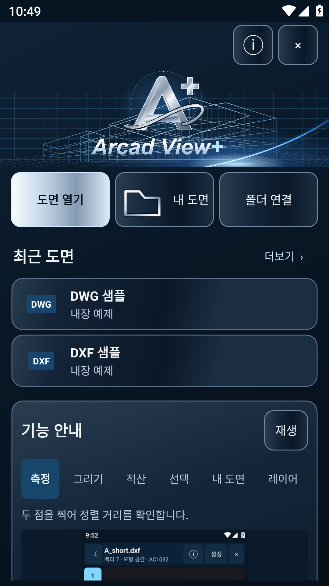
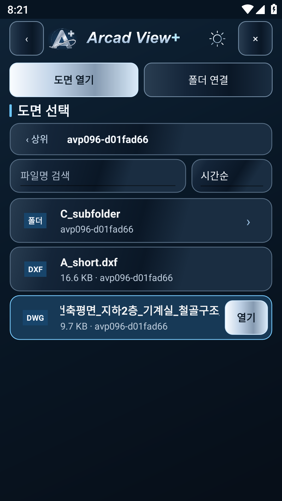
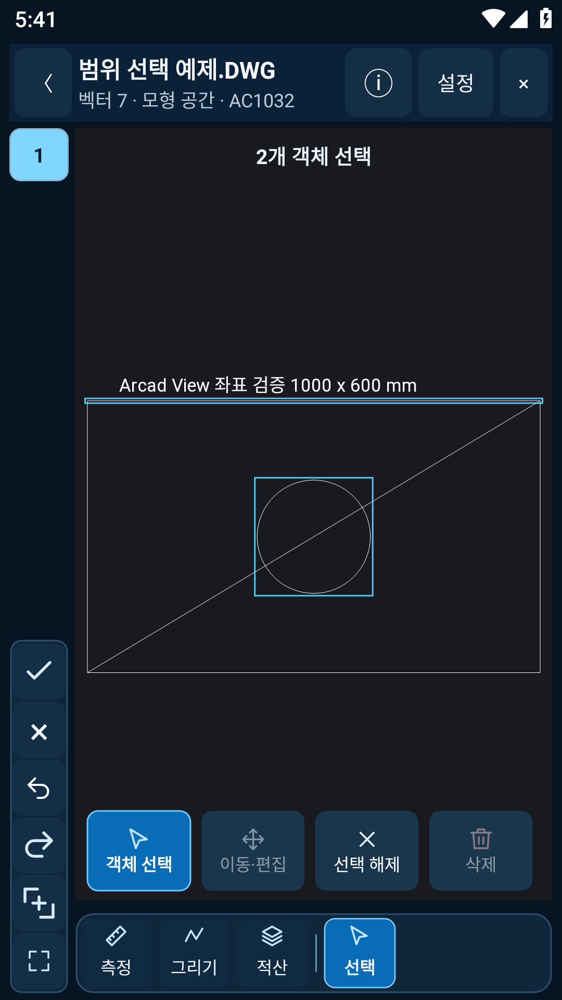
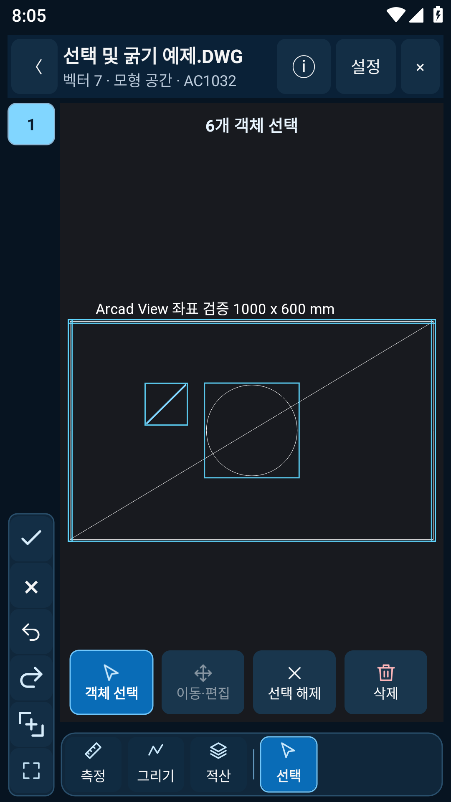

# Arcad View+

Android에서 DWG·DXF 도면을 열고, 거리를 재거나 도면 위에 표시할 수 있습니다.

## [↓ Android 설치 파일(APK) 바로 다운로드 · v0.9.24](https://github.com/gamzagui-collab/ArcadViewPlus-Releases/releases/download/v0.9.24/ArcadViewPlus-0.9.24.apk)

- **설치 파일** · ArcadViewPlus-0.9.24.apk · 약 96 MB
- **설치 환경** · Android 6.0 이상 · 64비트(arm64-v8a, x86_64) · GitHub 로그인 없이 다운로드

[항상 최신 릴리스와 변경 사항 보기](https://github.com/gamzagui-collab/ArcadViewPlus-Releases/releases/latest)

## 처음 설치하기

1. Android 휴대폰에서 위 **Android 설치 파일(APK) 바로 다운로드**를 누릅니다.
2. 다운로드 알림이나 **다운로드** 폴더에서 **ArcadViewPlus-0.9.24.apk**를 엽니다.
3. Android가 설치 권한을 요청하면 **설정 → 이 출처의 앱 설치 허용**을 선택하고 설치 화면으로 돌아옵니다. 메뉴 이름은 기기마다 다를 수 있습니다. [Android 설치 권한 안내](https://support.google.com/pixelphone/answer/7391672?hl=ko)
4. **설치**를 누른 뒤 **열기**를 누릅니다.

### 기존 사용자가 업데이트하기

기존 앱을 열면 필수 업데이트를 안내합니다. 다운로드가 끝나면 Android 설치 화면에서 **설치** 또는 **업데이트**를 누릅니다. 직접 확인하려면 홈 오른쪽 위 전원 버튼 옆 **ⓘ → 업데이트 확인**을 누릅니다. 기존 앱 위에 설치하면 도면과 작업 데이터가 유지됩니다.

  
  

## 도면 열기와 거리 측정

1. 처음에는 홈의 **폴더 연결 → Android에서 폴더 선택**에서 도면 폴더를 지정합니다. 이후 **도면 열기**를 누르면 Arcad View+ 탐색기가 열립니다. 목록에서 DWG나 DXF를 한 번 누르고, 선택된 줄 오른쪽의 **열기**를 누릅니다. 자동으로 흐르는 파일명에 손을 대면 현재 위치에서 멈춥니다. 이름 부분을 조금만 좌우로 밀어도 손가락을 따라가며, 손을 떼면 밀어서 확인한 위치를 유지합니다. 다른 폴더를 열고 싶으면 **폴더 연결**을 누릅니다.
2. 도면에서 손가락 하나를 끌어 화면을 이동합니다. 두 손가락을 벌리거나 모아 확대·축소합니다.
3. 하단 **측정**을 누르고 도면에서 두 점을 차례로 찍으면 정렬 거리가 표시됩니다.
4. 짧게 눌러 점을 입력하거나, 한 위치를 약 0.25초 누른 뒤 움직여 위치를 미세 조정합니다. 최근에 연 파일은 홈의 **내 도면** 또는 **최근 도면 → 더보기**에서 다시 열 수 있습니다. 최근 도면이 비어 있으면 DWG·DXF 샘플이 표시됩니다.

  
  

홈의 **해 아이콘**으로 상단 포스터와 도면 버튼을 접을 수 있습니다. 영상은 홈의 폭에 맞춰 자동 재생됩니다. **영상 확대**를 누르면 두 손가락 또는 +/−로 확대·축소할 수 있습니다. 영상 탭으로 일시정지하거나 다시 재생하고, 홈 영상 위에서 세로로 밀어 스크롤할 수 있습니다. 현재 제목은 굵게 표시됩니다. 영상 위에서 왼쪽으로 밀면 다음, 오른쪽으로 밀면 이전 영상으로 이동합니다. 한 편이 끝나면 다음 항목이 시작되며, 마지막 앱 정보가 끝나면 첫 측정부터 반복합니다. 화면과 GIF는 LDPlayer-9에서 예제 도면으로 캡처했습니다.

## 범위로 객체 선택하기

도면 하단의 **선택**을 누릅니다. 도면에서 시작점을 약 0.25초 누른 상태로 원하는 범위 끝까지 끌고 손을 떼세요. 선이나 객체의 일부가 사각형에 닿으면 선택됩니다. 왼쪽이나 오른쪽 어느 방향으로 끌어도 같은 규칙이 적용됩니다. **선택 해제**로 초기화할 수 있습니다.

짧게 눌러 개별 객체를 선택하고, 누르자마자 끌어 화면을 이동합니다. 범위를 선택한 뒤 **삭제**를 누르면 편집 가능한 객체를 한꺼번에 삭제할 수 있습니다. 왼쪽 **실행 취소** 한 번으로 삭제한 묶음을 복원합니다. 개별 객체의 선 굵기는 왼쪽 슬라이더를 탭하거나 끌어서 조절합니다.

  
  

## 이용 범위와 라이선스

기본 도면 보기와 정렬 거리·정렬 치수는 무료입니다. 유료 도구는 로그인과 해당 이용권이 필요합니다.

GUI's Arc Industry가 Arcad View+를 배포합니다. 홈 오른쪽 위 **ⓘ**에서 이용권을 연결하고 **오픈소스 및 라이선스**에서 구성요소별 고지를 확인할 수 있습니다.

- [제3자 구성요소 및 라이선스 고지](https://github.com/gamzagui-collab/ArcadViewPlus-Releases/releases/latest/download/THIRD-PARTY-NOTICES.zip)
- [GNU LibreDWG 대응 소스 및 GPL 라이선스 · v0.9.24](https://github.com/gamzagui-collab/ArcadViewPlus-Releases/releases/download/v0.9.24/GNU-LibreDWG-Corresponding-Source-0.14.9167.zip)
- [배포 파일 SHA-256 확인 · v0.9.24](https://github.com/gamzagui-collab/ArcadViewPlus-Releases/releases/download/v0.9.24/SHA256SUMS.txt)
